<!-- ШАПКА: GitHub сам выбирает тему посетителя -->
<picture>
  <source media="(prefers-color-scheme: dark)" srcset="header-dark.svg">
  <source media="(prefers-color-scheme: light)" srcset="header-light.svg">
  
</picture>

<!-- О СЕБЕ -->
<picture>
  <source media="(prefers-color-scheme: dark)" srcset="about-dark.svg">
  <source media="(prefers-color-scheme: light)" srcset="about-light.svg">
  
</picture>

<!-- АКТИВНОСТЬ: кольцевые диаграммы -->
<picture>
  <source media="(prefers-color-scheme: dark)" srcset="activity-dark.svg">
  <source media="(prefers-color-scheme: light)" srcset="activity-light.svg">
  
</picture>

<!-- СТЕК -->
<picture>
  <source media="(prefers-color-scheme: dark)" srcset="stack-dark.svg">
  <source media="(prefers-color-scheme: light)" srcset="stack-light.svg">
  
</picture>

<!-- ПРОЕКТЫ -->
<picture>
  <source media="(prefers-color-scheme: dark)" srcset="projects-dark.svg?v=2">
  <source media="(prefers-color-scheme: light)" srcset="projects-light.svg?v=2">
  
</picture>

**Публичные репозитории:** [musicnx](https://github.com/Shiona1/musicnx) — бета музыкального центра · [opencode-go-tray](https://github.com/Shiona1/opencode-go-tray) — лимиты OpenCode Go в трее

<!-- ГОСТЕВАЯ КНИГА -->

<!-- ПОДВАЛ -->
<picture>
  <source media="(prefers-color-scheme: dark)" srcset="footer-dark.svg">
  <source media="(prefers-color-scheme: light)" srcset="footer-light.svg">
  
</picture>

